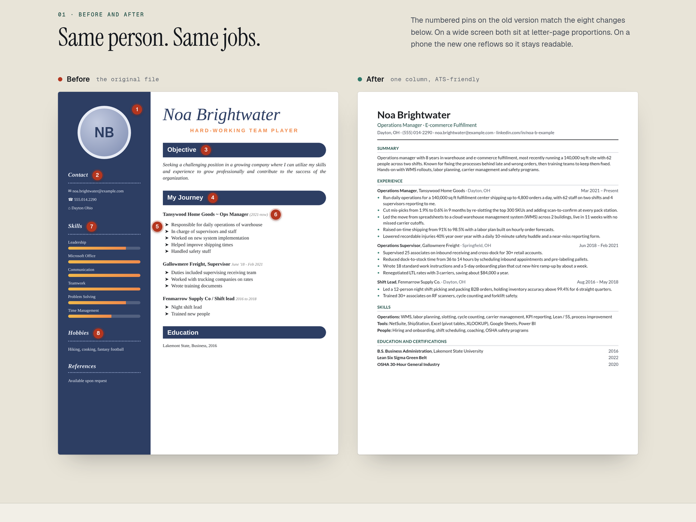

# Noa Brightwater: resume and LinkedIn makeover

A sample resume makeover for a made-up job seeker. A cluttered two-column resume (photo, skill bars, an objective, duty bullets) is rebuilt as a clean one-page resume that reads well in applicant tracking systems: one column, standard headings, one date format, and results with numbers in every bullet. The page also shows the bullet rewrites side by side, a keyword check against a sample job posting, a rewritten LinkedIn headline and About section, and the plain text pulled out of the finished PDF.

This is a concept demo. Noa Brightwater, Tansywood Home Goods, Gallowmere Freight, Fenmarrow Supply Co., Lakemont State University and Northvane Outfitters are all made up, and every number is example data. It is not client work.

## View it

Live page: https://alexmercerprojects.com/brightwater-resume-makeover/

Or open `docs/index.html` in a browser.

The finished resume is in `docs/` as a PDF (`Noa-Brightwater-resume-DEMO.pdf`) and an editable Word file (`Noa-Brightwater-resume-DEMO.docx`).



## What's in it

- Before and after at letter-page proportions, with eight numbered pins on the old version
- What changed and why: layout, contact line, summary, headings, bullets, dates, skills, and what got cut
- Five bullet rewrites, from duties to results
- A keyword check: 16 terms from a sample posting, matched against the text of each version (1 of 16 before, 16 of 16 after)
- LinkedIn: headline and About section, before and after, with character counts against LinkedIn's 220 and 2,600 limits
- Plain-text check: the unedited output of `pdftotext` on the finished PDF
- The process, start to finish

## Screenshots

- [Desktop](screenshots/desktop.png)
- [Phone](screenshots/mobile.png)
- [Bullet rewrites](screenshots/bullets.png)
- [Keyword check](screenshots/keywords.png)
- [LinkedIn before and after](screenshots/linkedin.png)

## How it's built

Plain HTML, CSS and a little vanilla JavaScript in `docs/`. All the content lives in `tools/build.py`, which writes the page and the print version of the resume, so the keyword and bullet counts are worked out from the actual text and always agree.

```
python3 tools/build.py        # page and print version
./tools/make-pdf.sh           # PDF (headless Chrome), Word file, plain text, then rebuilds the page
```

The resume uses Lato, a static font, so it embeds cleanly in the PDF and the text extracts in order. The page uses Geist, Geist Mono and Instrument Serif. All four are under the SIL Open Font License (see `docs/fonts/LICENSE.txt`).

## Contact

[alexmercer.projects@gmail.com](mailto:alexmercer.projects@gmail.com)
